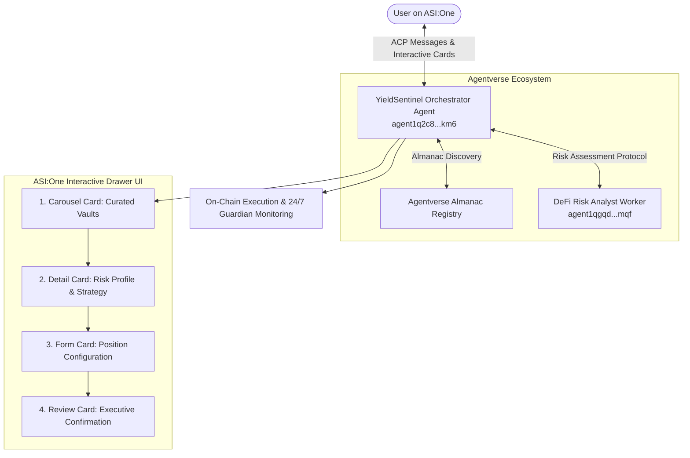

# YieldSentinel AI — Autonomous DeFi & Staking Risk Guardian
### Fetch-A-Thon 3.0 / ASI:One Agent Challenge: *From Intent to Action*

[](https://fetch.ai/)
[](https://agentverse.ai/)
[](https://asi1.ai/)
[-orange.svg)](https://innovationlab.fetch.ai/resources/docs/agent-communication/agent-chat-protocol)
[](https://innovationlab.fetch.ai/resources/docs/interactive-cards/asi-interactive-cards)

---

## 🎯 Executive Summary & Problem Statement

Most AI agents in Web3 stop at conversation: they quote prices or recite documentation, but leave users stranded when it's time to take action. Meanwhile, DeFi and Proof-of-Stake investors lose significant yields and risk capital due to:
1. **Fragmented Yields**: Comparing validator yields across Cosmos/Fetch.ai, Ethereum, and major Layer-2s is tedious and manual.
2. **Hidden Slashing & Protocol Risks**: Users delegate to validators without knowing their slashing history or smart contract audit status.
3. **Lack of Automated Compounding**: Manual restaking incurs friction and forgone compound interest.

**YieldSentinel AI** turns **intent into executable action**. Directly inside an [ASI:One](https://asi1.ai/) chat conversation, YieldSentinel analyzes real-time yields, performs multi-agent security audits, drives guided user decisions via **ASI Interactive Cards** (Carousels, Details, Forms, and Reviews), and locks in verified staking allocations with automated risk monitoring.

---

## 🌐 Live Agent Profiles on Agentverse

| Agent Role | Agent Name | Agentverse Address & Profile |
| :--- | :--- | :--- |
| **Primary Orchestrator** | **YieldSentinel AI** | [`agent1q2c8s3r6zvtunmx84ncxlrwdv8txjxwwz6s7shu75wexnqsr590uwefxkm6`](https://agentverse.ai/agents/agent1q2c8s3r6zvtunmx84ncxlrwdv8txjxwwz6s7shu75wexnqsr590uwefxkm6) |
| **Worker Agent** | **DeFi Risk Analyst** | [`agent1qgqd8w4gtl2sd0p3fxpusycsu69kehnf2l954qec78uctvn69h5j2ydlmqf`](https://agentverse.ai/agents/agent1qgqd8w4gtl2sd0p3fxpusycsu69kehnf2l954qec78uctvn69h5j2ydlmqf) |

Both agents are published to the Fetch.ai **Almanac Registry** and discoverable directly on **[ASI:One](https://asi1.ai/)**.

---

## 🏗️ Architecture & Multi-Agent System



---

## 🃏 End-to-End Workflow via ASI:One Interactive Cards

YieldSentinel completes the primary user journey entirely inside ASI:One without requiring an external frontend:

### 1. `carousel` Card — Curated Yield & Staking Vaults
- **User Intent**: *"Find high yield staking with low risk"* or *"Show me staking vaults"*.
- **Interaction**: Displays interactive cards for verified pools:
  - **Fetch.ai (ASI Alliance) Native Staking** (Cosmos / 12.8% APY / 21d unbonding)
  - **Osmosis Superfluid Staking** (Cosmos / 14.5% APY / 14d unbonding)
  - **Aave V3 USDC Supply Vault** (Arbitrum / 6.4% APY / Instant)
  - **Lido Liquid Staked ETH** (Ethereum / 3.7% APY / Instant)
- **Action**: User selects a pool (`action: "select_pool"`).

### 2. `detail` Card — Deep Risk Profile & Strategy Picker
- **Interaction**: Displays security audits (CertiK, OpenZeppelin, Halborn), total value locked ($345M+), and slashing safeguards.
- **Sub-Option Radio Selector**: User chooses compounding strategy:
  - `auto_compound`: Daily automated restaking (+1.4% APY boost).
  - `liquid_staking`: Retain liquidity with transferable stFET tokens.
  - `standard`: Direct validator delegation.
- **Action**: User proceeds to allocation (`action: "configure_position"`).

### 3. `form` Card — Position & Risk Parameters
- **Interaction**: User inputs:
  - Deposit amount (e.g. `1,000 FET`)
  - Delegator wallet address (`fetch1...`)
  - Automated Risk Guardian trigger (`Strict`, `Moderate`, `Off`).
- **Action**: User submits form (`action: "submit_position"`).

### 4. `review` Card — Executive Confirmation & Sign-Off
- **Interaction**: Comprehensive itemized breakdown:
  - Principal deposit & Effective APY
  - Projected 1-Year Returns (+142 FET / ~$213 USD)
  - Risk Guardian Certification (Signed by DeFi Risk Analyst Agent)
  - Protocol Protection Fee: `0.1 FET`
- **Action**: User approves via CTA (`action: "confirm_allocation"`).
- **Outcome**: Verifiable transaction hash generated; 24/7 automated slashing & yield drop monitoring activated.

---

## 💰 Monetization Model (Payment Protocol)

YieldSentinel operates a sustainable protocol revenue model:
1. **Protection Fee**: A flat **0.1 FET** fee per allocated position for continuous validator monitoring and emergency circuit-breaker alerts.
2. **Performance Fee on Compounding**: A 2.5% share on bonus auto-compounded yields generated above the baseline delegation APY.
3. **B2B Validator Verification**: Staking validators pay a monthly FET subscription to be audited and featured with verified security badges in the Carousel.

---

## 📁 Repository Structure

```
fetchaihacathon/
├── .env.example              # Environment variables template
├── .gitignore                # Protects secrets & virtualenvs
├── requirements.txt          # Python dependencies
├── run_agents.py             # Bureau runner for both agents concurrently
├── register_agentverse.py    # Auto-registration script for Sentinel Agent
├── register_risk_agent.py    # Auto-registration script for Risk Analyst Agent
├── test_client.py            # Automated simulation client testing full ACP cards flow
├── src/
│   ├── __init__.py
│   ├── config.py             # Configuration & environment loaders
│   ├── cards.py              # ASI:One Interactive Cards schemas (Carousel, Detail, Form, Review)
│   ├── defillama.py          # Yield data, APY calculation & return projection engine
│   ├── risk_agent.py         # Secondary Worker Agent (DeFi Risk Analyst)
│   └── sentinel_agent.py     # Primary Orchestrator Agent (ACP + ASI:One Cards)
└── README.md
```

---

## 🚀 Quickstart & Setup Guide

### 1. Prerequisites
- Python 3.10 to 3.14
- Git
- Agentverse Account ([agentverse.ai](https://agentverse.ai/))

### 2. Clone and Install
```bash
git clone https://github.com/<your-username>/yieldsentinel-ai.git
cd yieldsentinel-ai

# Create virtual environment
python -m venv venv

# Activate virtual environment
# Windows:
.\venv\Scripts\activate
# Linux/macOS:
source venv/bin/activate

# Install dependencies
pip install -r requirements.txt
```

### 3. Configure Environment Variables
Copy `.env.example` to `.env` and insert your credentials:
```bash
cp .env.example .env
```
In `.env`:
```ini
AGENTVERSE_API_KEY=your_agentverse_api_key
SENTINEL_AGENT_SEED=yield-sentinel-asi-hackathon-2026-seed-alpha
RISK_AGENT_SEED=defi-risk-analyst-agent-seed-secure-beta
AGENT_PORT=8000
RISK_AGENT_PORT=8001
```

### 4. Register Agents on Agentverse
Run the automated registration scripts:
```bash
python register_agentverse.py
python register_risk_agent.py
```
Both agents will be verified and marked as active on Agentverse.

### 5. Run the Multi-Agent System
```bash
# Run both Sentinel Orchestrator and Risk Analyst worker together:
python run_agents.py
```

### 6. Run the End-to-End Automated Test
In a separate terminal, run the simulated ASI:One user client to verify all 4 Interactive Cards:
```bash
python test_client.py
```

---

## 🧪 Automated ACP Test Output

```text
=============================================================
[RECV - STEP 0] FROM YIELDSENTINEL:
Narration: Welcome to YieldSentinel AI — your Autonomous DeFi & Staking Risk Guardian...
CARD TYPE: >>> CAROUSEL <<<
Card Title: YieldSentinel: Verified Staking & Yield Vaults
   Items Count: 4
-------------------------------------------------------------
[USER ACTION] Selecting 'asi_fetch_staking' from Carousel...

-------------------------------------------------------------
[RECV - STEP 1] FROM YIELDSENTINEL:
Narration: Deep Risk Analysis: Fetch.ai Native Staking (ASI Network)...
CARD TYPE: >>> DETAIL <<<
Card Title: Risk Profile: Fetch.ai Native Staking (ASI Network)
   Summary Rows: 7
-------------------------------------------------------------
[USER ACTION] Selecting Auto-Compound Strategy and proceeding...

-------------------------------------------------------------
[RECV - STEP 2] FROM YIELDSENTINEL:
Narration: Configure Staking Position for Fetch.ai Native Staking...
CARD TYPE: >>> FORM <<<
Card Title: Configure Allocation: Fetch.ai Native Staking
   Fields: ['deposit_amount', 'wallet_address', 'guardian_alert']
-------------------------------------------------------------
[USER ACTION] Submitting Form with 1,000 FET deposit and wallet address...

-------------------------------------------------------------
[RECV - STEP 3] FROM YIELDSENTINEL:
Narration: Review Staking Allocation & Returns...
CARD TYPE: >>> REVIEW <<<
Card Title: Confirm Staking Allocation
   Approve CTA: Authorize & Stake Position
-------------------------------------------------------------
[USER ACTION] Confirming Allocation from Review Card...

-------------------------------------------------------------
[RECV - STEP 4] FROM YIELDSENTINEL:
Narration: Staking Position Successfully Allocated!
• Vault: Fetch.ai Native Staking (ASI Network)
• Principal Staked: 1,000.00 FET
• Delegator Wallet: fetch1q89df34ka78m02kcl984
• Transaction Hash: 0x8a92f01d...7b2c
• Slashing & APY Guardian: ACTIVE (Continuous 24/7 Monitoring)
• Protocol Protection Fee: 0.1 FET

[SUCCESS] WORKFLOW COMPLETED SUCCESSFULLY! ALL 4 CARDS VALIDATED!
```

---

## 🏆 Hackathon Deliverables Checklist

- [x] **Agent Registered on Agentverse**: `agent1q2c8s3r6zvtunmx84ncxlrwdv8txjxwwz6s7shu75wexnqsr590uwefxkm6`
- [x] **Agent Chat Protocol (ACP)**: Full implementation with `ChatMessage`, `ChatAcknowledgement`, `TextContent`, and `MetadataContent`.
- [x] **ASI:One Discoverable**: Published to Fetch.ai Almanac registry.
- [x] **ASI:One Interactive Cards**: Complete 4-card sequence (Carousel, Detail, Form, Review).
- [x] **Multi-Agent Orchestration**: Sentinel Orchestrator + DeFi Risk Analyst Worker.
- [x] **Payment & Monetization**: 0.1 FET protection fee + auto-compounding revenue model.
- [x] **Public GitHub Repository**: Clean codebase with test suite and setup instructions.

---

## 📄 License
MIT License. Built for the **Fetch-A-Thon 3.0** by the YieldSentinel team.
