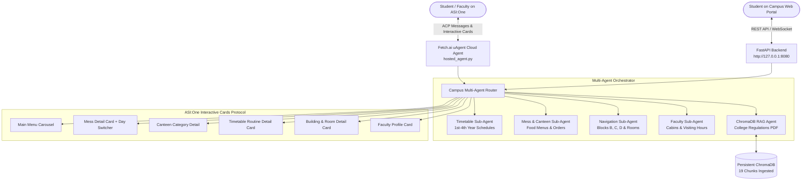

# 🎓 CampusMitra AI — Autonomous Indian Campus Concierge
### Fetch.ai / ASI:One Agent Challenge (Fetch-A-Thon 3.0) — *From Intent to Action*

[](https://fetch.ai/)
[](https://agentverse.ai/)
[](https://asi1.ai/)
[](https://fastapi.tiangolo.com/)
[](https://react.dev/)
[](https://www.trychroma.com/)

---

## 🌟 Executive Summary

**CampusMitra AI** is an autonomous, multi-agent campus concierge designed specifically for Indian university and college ecosystems (Roorkee Institute of Technology / RIT Edition). Built natively on **Fetch.ai's Agent Chat Protocol (ACP)** and the **ASI:One Interactive Cards Protocol**, CampusMitra AI solves daily student and faculty friction by seamlessly handling:

1. **Official Class Timetables (All 4 Years)**: Complete Monday–Saturday routines for 1st Year (Room B-001), 2nd Year (Room C-202), 3rd Year (Room C-212), and 4th Year (Room D-202).
2. **Boys Hostel Mess Food (Monday to Sunday)**: 4 meals daily (Breakfast, Lunch, Evening Tea/Snacks, Dinner) with real menu items (Aloo Paratha, Shahi Paneer, Chole Bhature, Kheer, Jalebi, Ice Cream).
3. **Campus Canteen Menu**: Burgers, Full Plate Momos (8 pcs), Chilled Cold Drinks, Hot/Cold Coffee, Kadak Chai, French Fries, and Maggi with student pricing.
4. **Classroom Navigation & Floor Maps**: Academic Block B, Block C, Block D, and Central Amenities Complex.
5. **Faculty Directory & Cabins**: HOD CSE, Professors, subjects taught, cabin numbers, and office visiting hours.
6. **Academic Handbook RAG**: Semantic vector retrieval powered by **ChromaDB** indexing official college regulations, 75% attendance policy, and exam rules.
7. **Zero-Friction UI**: Full support for **ASI Interactive Cards Protocol v1** (`carousel`, `detail`, `form`, `review`) inside ASI:One and a local **React + Tailwind CSS** dashboard.

---

## 🌐 Live Agent on Agentverse & ASI:One

| Attribute | Details |
| :--- | :--- |
| **Agent Name** | `CampusMitra AI` / `campus_mitra_cloud` |
| **Agent Address** | [`agent1qt6msz8tyzg629x2uhvjn025sd27erneyl4427fpgdxqq74ycryquewctvc`](https://agentverse.ai/agents/agent1qt6msz8tyzg629x2uhvjn025sd27erneyl4427fpgdxqq74ycryquewctvc) |
| **Agentverse Profile** | [https://agentverse.ai/agents/agent1qt6msz8tyzg629x2uhvjn025sd27erneyl4427fpgdxqq74ycryquewctvc](https://agentverse.ai/agents/agent1qt6msz8tyzg629x2uhvjn025sd27erneyl4427fpgdxqq74ycryquewctvc) |
| **ASI:One Direct Interaction** | [https://asi1.ai/](https://asi1.ai/) |
| **Status** | **Active & Discoverable** (Agent Chat Protocol:0.3.0) |

---

## 🏗️ Architecture & Technology Stack



---

## 📂 Project Structure

```
fetchaihacathon/
├── campus_mitra/
│   ├── backend/
│   │   ├── agents/               # Multi-agent orchestrator & specialized agents
│   │   │   ├── orchestrator.py    # LangGraph-style agent routing & card dispatch
│   │   │   ├── timetable_agent.py # Class timetable resolution
│   │   │   ├── mess_canteen_agent.py # Mess food & fast food menus
│   │   │   ├── navigation_agent.py# Room & floor map routing
│   │   │   ├── faculty_agent.py   # Professor profiles & cabins
│   │   │   └── rag_agent.py       # ChromaDB vector retrieval
│   │   ├── cards/
│   │   │   └── card_builder.py    # ASI:One Interactive Cards (v1 protocol)
│   │   ├── data/
│   │   │   ├── campus_data.py     # Complete database (Timetables, Mess, Canteen, Buildings, Faculty)
│   │   │   └── campus_handbook.pdf# Official college PDF regulations document
│   │   ├── rag/
│   │   │   ├── chroma_db/         # Persistent ChromaDB vector storage (19 chunks)
│   │   │   ├── pdf_extractor.py   # PDF text extraction (pypdf + streams)
│   │   │   └── vector_store.py    # Embeddings & similarity search
│   │   ├── main.py                # FastAPI REST API & static server
│   │   └── uagent_service.py      # Local Fetch.ai uAgent ACP service
│   ├── frontend/
│   │   └── index.html             # React 18 + Tailwind CSS 7-tab web app
│   ├── hosted_agent.py            # Self-contained single-file cloud agent for Agentverse
│   ├── register_agentverse.py     # Agentverse registration & sync script
│   ├── run_campus.py              # Master runner (FastAPI + uAgent concurrent)
│   └── test_campus_client.py      # Automated ACP test client
├── .env.example                   # Environment configuration template
├── .gitignore                     # Git ignore rules (secrets & caches protected)
└── README.md                      # Complete project documentation
```

---

## 🚀 Quickstart Guide

### 1. Clone & Set Up Virtual Environment

```bash
git clone https://github.com/<your-username>/fetchaihacathon.git
cd fetchaihacathon

# Create virtual environment
python -m venv venv
venv\Scripts\activate   # On Windows
# source venv/bin/activate  # On Linux/macOS

# Install dependencies
pip install -r requirements.txt
```

### 2. Configure Environment Variables

Copy the `.env.example` template:
```bash
cp campus_mitra/.env.example campus_mitra/.env
```
Fill in your `AGENTVERSE_API_KEY` (obtain free from [Agentverse.ai](https://agentverse.ai) -> Profile -> API Keys).

### 3. Launch Local Master Daemon

```bash
python campus_mitra/run_campus.py
```
This concurrently starts:
- 🌐 **Web Dashboard & REST API**: [http://127.0.0.1:8080](http://127.0.0.1:8080)
- 🤖 **Local Fetch.ai uAgent (ACP)**: `http://127.0.0.1:8000/submit`

---

## ☁️ 24/7 Cloud Deployment on Agentverse

You can deploy CampusMitra AI to run **24/7 without needing a local server**:

1. Open **[Agentverse.ai](https://agentverse.ai/)** and log in.
2. Click **"+ New Agent"** ➔ Select **"Blank Agent"**.
3. Open `campus_mitra/hosted_agent.py`, copy all contents, and paste into the Agentverse Web Editor.
4. Click **"Run"** in the top right.
5. Your agent is now live and public on the Fetch.ai network!

---

## 💬 Sample Prompts to Test on ASI:One (`https://asi1.ai/`)

Try asking CampusMitra AI directly on ASI:One:
- *"Hi, I am a student here. What can you help me with?"* (Opens Main Menu Carousel)
- *"What is on the menu for Monday in the boys hostel mess?"* (Opens Mess Detail Card)
- *"Can you show me the canteen fast food menu, especially burgers and momos?"* (Opens Canteen Card)
- *"Show me the 1st year CSE timetable for Monday"* (Opens Room B-001 Schedule)
- *"What classes does 2nd year CSE have on Wednesday?"* (Opens Room C-202 Schedule)
- *"What is the 4th year routine for Friday?"* (Opens Room D-202 Schedule)
- *"Where is room C-202 located and which building is it in?"* (Opens Block C Floor Map)
- *"Who is the HOD of Computer Science and where is his cabin?"* (Opens Dr. Lokesh Kumar's Profile)
- *"What is the minimum attendance requirement to appear in semester exams?"* (Retrieves 75% rule via ChromaDB RAG)

---

## 🛡️ License & Track Submission
Built for the **Fetch.ai / ASI:One Agent Challenge (Fetch-A-Thon 3.0)** — *From Intent to Action*.
Developed by **Tanishk Shukla** (Roorkee Institute of Technology).
